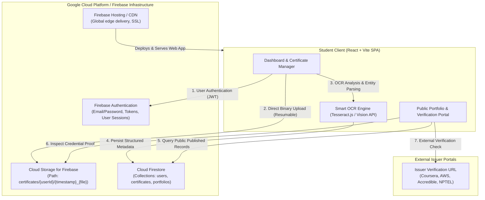

# SkillVault | Cloud-Based Skill Credential & Portfolio System


---

## 📌 1. Project Overview & Objectives

In academic and professional hiring, students acquire various course completions, internship letters, and hackathon certificates. However, credentials are often fragmented across PDFs and emails without centralized verification or structured skill indexing.

**SkillVault** solves this with a complete cloud-native architecture:
1. **Cloud Binary Persistence:** Uploads original certificate documents (PDF/PNG/JPG) to **Cloud Storage for Firebase** with owner-scoped access rules.
2. **Intelligent Cloud Document Processing (OCR):** Genuine OCR pipeline extracts recipient names, issuing organizations (Coursera, Udemy, AWS, Google, NPTEL), issue dates, and unique credential IDs.
3. **Structured Cloud Database:** Stores certificate metadata, categories, and verification logs in **Cloud Firestore** with strict security rules.
4. **Credential Verification Pipeline:** Enforces a defensible multi-tier authenticity workflow (`UPLOADED` → `OCR_PROCESSED` → `PENDING_REVIEW` → `VERIFIED`) to prevent unverified claims.
5. **Dynamic Digital Portfolio & Public Verification:** Generates a unique, shareable public portfolio URL (`#/p/:userId`) with student privacy controls, plus a dedicated recruiter verification registry.

---

## 🏗️ 2. Cloud Architecture



---

## 🔐 3. Cloud Security & Access Rules

Security is enforced at the cloud infrastructure layer, not merely in client code:

### Firestore Security Rules (`firestore.rules`)
- **User Profile Isolation:** Only authenticated owners can write to `users/{userId}`.
- **Certificate Data Isolation:** Students can read, create, update, and delete only documents where `request.auth.uid == userId`.
- **Controlled Public Sharing:** Public visitors can read certificates **only if** `resource.data.isPublished == true`.

### Cloud Storage Security Rules (`storage.rules`)
- Files stored under `certificates/{userId}/` are restricted to `request.auth.uid == userId`.
- Restricts uploaded file sizes to `< 10MB` and validates MIME types (`image/*` and `application/pdf`).

---

## 🚀 4. Local Setup & Quick Start

### Prerequisites
- Node.js `v20.x` or higher
- Windows PowerShell / Command Prompt

### Step 1: Install Dependencies
```bash
cd "d:\CC mini project\skill-portfolio"
npm.cmd install
```

### Step 2: Configure Firebase Environment (Optional for Live Firebase)
Create a `.env` file from `.env.example`:
```bash
cp .env.example .env
```
Fill in your Firebase credentials from [Firebase Console](https://console.firebase.google.com):
```env
VITE_FIREBASE_API_KEY=AIzaSy...
VITE_FIREBASE_AUTH_DOMAIN=your-project.firebaseapp.com
VITE_FIREBASE_PROJECT_ID=your-project
VITE_FIREBASE_STORAGE_BUCKET=your-project.firebasestorage.app
VITE_FIREBASE_MESSAGING_SENDER_ID=1234567890
VITE_FIREBASE_APP_ID=1:1234567890:web:...
```

> **Note on Cloud Sandbox Mode:** If `.env` is not yet configured, SkillVault automatically runs in **Cloud Sandbox Mode** with complete mock cloud persistence and pre-seeded sample certificates so evaluators can test every single feature immediately without setup delay.

### Step 3: Run the Development Server
```bash
npm.cmd run dev
```
Open `http://localhost:5173` in your browser.

### Step 4: Build for Production
```bash
npm.cmd run build
```

---

## 🌐 5. Deployment to Firebase Hosting

To deploy your live cloud application:

1. Install Firebase CLI globally:
   ```bash
   npm.cmd install -g firebase-tools
   ```
2. Log in to Firebase:
   ```bash
   firebase login
   ```
3. Initialize hosting in `skill-portfolio`:
   ```bash
   firebase init hosting
   ```
   - Public directory: `dist`
   - Single-page app: `Yes`
   - Automatic GitHub actions: `No` (or as preferred)
4. Deploy:
   ```bash
   npm.cmd run build
   firebase deploy
   ```

---

## 🎯 6. Key Features Implemented

| Module | Features |
|---|---|
| **1. Authentication** | Registration, Login, Logout, Session Persistence, Fast 1-Click Evaluator Login |
| **2. Certificate Cloud Storage** | PDF/PNG/JPG validator, 10MB limit, resumable chunked upload, live progress bar |
| **3. Smart Cloud OCR** | Automated text parsing, extracts Title, Issuer, Date, Credential ID, confidence score |
| **4. Verification Pipeline** | 4-tier verification (`UPLOADED`, `OCR_PROCESSED`, `PENDING_REVIEW`, `VERIFIED`) |
| **5. Student Dashboard** | Real-time counts, category distribution bar charts, recent certificates |
| **6. Shareable Portfolio** | Unique URL (`#/p/:userId`), public/private toggle, selective publishing |
| **7. Verification Registry** | Public lookup tool for recruiters to verify credential authenticity by ID |
| **8. Profile Manager** | USN, Degree, Department, Semester, Bio, verified skill demonstration tags |

---
